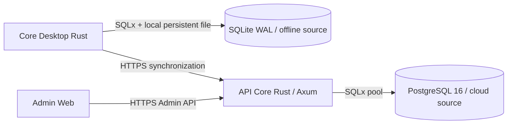

# 40Labs Database Architecture and Integrity

**Schema snapshot:** 2026-11-13. SQLite inventory is derived by applying all 34 SQLx migrations in order with SQLite 3.50.4. PostgreSQL inventory was introspected from PostgreSQL 16 after API Core migrations 0000–0009 on a disposable local test database.

## Architecture

Core Desktop owns local offline operational records and the SQLite sync outbox. API Core owns cloud device enrollment, activation, Admin state, and synchronized copies/telemetry in PostgreSQL. Admin Web accesses PostgreSQL through API Core only. No database replacement or direct client-to-PostgreSQL path is intended.

## Migration and Startup Contract

- Desktop release DB path: Tauri `app_data_dir/40labs.db`; debug DB: repository `dev-data/40labs-dev.db`. SQLx connection setup enables WAL and foreign keys. SQLx migration errors fail startup; mismatch handling never deletes/recreates the DB.
- SQLite migrations are `infra/db/sqlite-schema/migrations/0001` through `0034`, SQLx tracked. The registration reconciliation for 0010 records that exact migration checksum only when all its expected columns exist and version 0009 succeeded.
- API Core migrations are `services/api-core/migrations/0000` through `0009`, SQLx tracked. Version 0000 converts the historical raw sync foundation into a versioned baseline. Existing installs with all six core sync tables but no ledger row are adopted with the exact SQLx version-0 checksum; fresh installs run 0000 normally.
- PostgreSQL migrations use SQLx migration locking and transactional DDL by default. Startup fails on dirty migration, checksum mismatch, or SQL error. SQLite also fails startup without reset. Fix with forward migrations; never edit released migrations.
- Existing SQLite 0001–0031 and API Core 0001–0007 were not edited. `infra/db/postgres/0001_sync_foundation.sql` remains the historical source copied to tracked API migration 0000.

## Migration Inventory

### SQLite / Core Desktop

- `infra/db/sqlite-schema/migrations/0001_init.sql` — 40LabsCore — SQLite Schema, Migration 0001 (init)
- `infra/db/sqlite-schema/migrations/0002_lab_order_cancelled_status.sql` — 0002_lab_order_cancelled_status
- `infra/db/sqlite-schema/migrations/0003_lab_sample_status.sql` — 0003_lab_sample_status
- `infra/db/sqlite-schema/migrations/0004_supplier_follow.sql` — 40LabsCore — SQLite Schema, Migration 0002 (supplier_follow)
- `infra/db/sqlite-schema/migrations/0005_notifications.sql` — 40LabsCore — SQLite Schema, Migration 0003 (notifications)
- `infra/db/sqlite-schema/migrations/0006_scheduling.sql` — 40LabsCore — SQLite Schema, Migration 0004 (scheduling)
- `infra/db/sqlite-schema/migrations/0007_notification_messages.sql` — 40LabsCore — SQLite Schema, Migration 0005 (notification messages and attachments)
- `infra/db/sqlite-schema/migrations/0008_auth.sql` — 40LabsCore — SQLite Schema, Migration 0008 (auth)
- `infra/db/sqlite-schema/migrations/0009_auth_pin_nullable.sql` — 40LabsCore — SQLite Schema, Migration 0009 (auth pin nullable & table rebuild)
- `infra/db/sqlite-schema/migrations/0010_business_registration_fields.sql` — Migration 0010: Business registration fields (already applied in migration 0008)
- `infra/db/sqlite-schema/migrations/0011_integrations_config.sql` — Migration 0011: Integrations Config
- `infra/db/sqlite-schema/migrations/0012_lab_operations.sql` — Persist laboratory equipment and quality control history without changing
- `infra/db/sqlite-schema/migrations/0013_staged_notification_attachments.sql` — Attachments are staged before a message is sent. The send transaction binds
- `infra/db/sqlite-schema/migrations/0014_appearance_system_and_language.sql` — 0014_appearance_system_and_language
- `infra/db/sqlite-schema/migrations/0015_partner_facilities.sql` — 0015_partner_facilities
- `infra/db/sqlite-schema/migrations/0016_notification_threads.sql` — 0016_notification_threads
- `infra/db/sqlite-schema/migrations/0017_threads.sql` — 40Labs Core — SQLite Schema, Migration 0017 (Real Threads, one per counterparty)
- `infra/db/sqlite-schema/migrations/0018_dispensing_instructions.sql` — 0018_dispensing_instructions
- `infra/db/sqlite-schema/migrations/0019_scheduling_enabled_and_attachments.sql` — 40LabsCore — SQLite Schema, Migration 0019 (scheduling enabled & attachments)
- `infra/db/sqlite-schema/migrations/0020_medicine_image_path.sql` — 0020_medicine_image_path
- `infra/db/sqlite-schema/migrations/0021_sample_expiry_and_events.sql` — Add expiry fields to lab_sample and test_catalog_entry, and create append-only sample_event table.
- `infra/db/sqlite-schema/migrations/0022_lab_reports.sql` — 0022_lab_reports.sql
- `infra/db/sqlite-schema/migrations/0023_marketplace_preview.sql` — [PHASE: marketplace-preview — Data foundation]
- `infra/db/sqlite-schema/migrations/0024_lab_workflow_runs.sql` — Persistent workflow execution runs and steps for laboratory procedures
- `infra/db/sqlite-schema/migrations/0025_lab_stage_attachments.sql` — Stage-level file attachments for laboratory workflow runs
- `infra/db/sqlite-schema/migrations/0026_sync_foundation.sql` — 40LabsCore — Migration 0026: Sync Foundation (Desktop -> Cloud, One-Way Push)
- `infra/db/sqlite-schema/migrations/0027_sync_fixup.sql` — 40LabsCore — Migration 0027: Sync Fix-up (Drop tmda_license_no, price_history entity, compaction fix)
- `infra/db/sqlite-schema/migrations/0028_branch_code_unique.sql` — Migration 0028: Add district column and unique index on branch(business_id, branch_code)
- `infra/db/sqlite-schema/migrations/0029_app_user_blocked_fields.sql` — 0029_app_user_blocked_fields
- `infra/db/sqlite-schema/migrations/0030_user_totp.sql` — 0030_user_totp
- `infra/db/sqlite-schema/migrations/0031_idempotency_cache.sql` — 0031_idempotency_cache
- `infra/db/sqlite-schema/migrations/0032_integrity_guards.sql` — Database-level tenant ownership guards for local synchronized/business records.
- `infra/db/sqlite-schema/migrations/0033_sale_idempotency_unique.sql` — Enforce one sale per workspace idempotency key.
- `infra/db/sqlite-schema/migrations/0034_branch_business_scope.sql` — Allow a business to own multiple branches while keeping them in the same workspace.

### PostgreSQL / API Core

- `services/api-core/migrations/0000_sync_foundation.sql` — 40LabsCloud — Postgres Migration 0001: Sync Foundation
- `services/api-core/migrations/0001_activation.sql` — 0001_activation
- `services/api-core/migrations/0002_admin_ops.sql` — PHASE: Admin-A
- `services/api-core/migrations/0003_sync_ops.sql` — Migration 0003: Sync Operations & Device Telemetry
- `services/api-core/migrations/0004_analytics_indexes.sql` — Migration 0004: Analytics Indexes for Performance
- `services/api-core/migrations/0005_admin_business_fields.sql` — Additive admin profile fields for installations created before the admin UI.
- `services/api-core/migrations/0006_device_credentials.sql` — Versioned device credential enrollment and sync isolation metadata.
- `services/api-core/migrations/0007_admin_security.sql` — Durable administrative authentication state and TOTP replay prevention.
- `services/api-core/migrations/0008_database_integrity.sql` — Additive integrity constraints for synchronized cloud records.
- `services/api-core/migrations/0009_sync_audit_integrity.sql` — Keep synchronized price history and replay identity append-only.

Dependency order: PostgreSQL 0000 sync tables → 0001 activation registry → 0002 admin operations → 0003 sync telemetry → 0004 analytics indexes → 0005 business fields → 0006 enrollment/scope metadata → 0007 durable admin security → 0008 tenant constraints → 0009 immutable sync history. SQLite applies numeric order; 0026 adds sync/outbox/versioning, 0027 rebuilds the outbox schema, 0032 adds tenant guards, 0033 makes sale idempotency keys unique per workspace, and 0034 guards business workspace ownership without conflating branch IDs.

## Database Ownership

| Database | Owner | Authoritative records |
|---|---|---|
| SQLite | Core Desktop | Offline POS/lab/identity/workflow and local outbox; user operations remain available offline |
| PostgreSQL | API Core | Device enrollments, activation, admin sessions, cloud copies of supported sync entities, telemetry and operations |

## SQLite Schema Inventory

For every table, columns show declared SQLite type, `NOT NULL`, and primary key. Foreign keys, indexes, uniqueness and CHECK expressions are listed from the fully migrated schema.

### `app_user`
- Columns: `id` TEXT PK, `workspace_id` TEXT NOT NULL, `branch_id` TEXT NOT NULL, `username` TEXT NOT NULL, `first_name` TEXT NOT NULL, `last_name` TEXT NOT NULL, `full_name` TEXT NOT NULL, `phone` TEXT, `role` TEXT NOT NULL, `role_preset` TEXT NOT NULL, `is_superintendent` INTEGER NOT NULL DEFAULT 0, `active` INTEGER NOT NULL DEFAULT 1, `owner_id` TEXT, `must_change_credentials` INTEGER NOT NULL DEFAULT 0, `last_login_at` TEXT, `created_by_user_id` TEXT, `created_at` TEXT NOT NULL DEFAULT strftime('%Y-%m-%dT%H:%M:%fZ','now'), `updated_at` TEXT NOT NULL DEFAULT strftime('%Y-%m-%dT%H:%M:%fZ','now'), `blocked_at` TEXT, `blocked_reason` TEXT
- Foreign keys: owner_id → owner.id
- Indexes / unique constraints: `idx_app_user_workspace_username` UNIQUE (workspace_id, username); `sqlite_autoindex_app_user_1` UNIQUE (id)
- CHECK: CHECK (role IN ('sudo','staff'); CHECK (is_superintendent IN (0,1); CHECK (active IN (0,1); CHECK (must_change_credentials IN (0,1)

### `audit_log`
- Columns: `id` TEXT PK, `workspace_id` TEXT NOT NULL, `branch_id` TEXT NOT NULL, `action` TEXT NOT NULL, `performed_by_user_id` TEXT, `target_entity_type` TEXT NOT NULL, `target_entity_id` TEXT NOT NULL, `metadata` TEXT NOT NULL DEFAULT '{}', `created_at` TEXT NOT NULL DEFAULT strftime('%Y-%m-%dT%H:%M:%fZ','now')
- Foreign keys: performed_by_user_id → app_user.id
- Indexes / unique constraints: `idx_audit_actor` (performed_by_user_id); `idx_audit_target` (target_entity_type, target_entity_id); `sqlite_autoindex_audit_log_1` UNIQUE (id)
- CHECK: none

### `bound_device`
- Columns: `id` TEXT PK, `workspace_id` TEXT NOT NULL, `branch_id` TEXT NOT NULL, `device_label` TEXT NOT NULL, `public_key` TEXT NOT NULL, `bound_by_user_id` TEXT NOT NULL, `bound_at` TEXT NOT NULL DEFAULT strftime('%Y-%m-%dT%H:%M:%fZ','now'), `last_sync_at` TEXT, `status` TEXT NOT NULL DEFAULT 'active', `revoked_at` TEXT, `created_at` TEXT NOT NULL DEFAULT strftime('%Y-%m-%dT%H:%M:%fZ','now'), `updated_at` TEXT NOT NULL DEFAULT strftime('%Y-%m-%dT%H:%M:%fZ','now')
- Foreign keys: bound_by_user_id → app_user.id
- Indexes / unique constraints: `idx_bound_device_user` (bound_by_user_id); `idx_bound_device_workspace` (workspace_id, branch_id); `sqlite_autoindex_bound_device_1` UNIQUE (id)
- CHECK: CHECK (status IN ('active','revoked')

### `branch`
- Columns: `id` TEXT PK, `workspace_id` TEXT NOT NULL, `branch_id` TEXT NOT NULL, `business_id` TEXT NOT NULL, `name` TEXT NOT NULL, `location` TEXT, `branch_code` TEXT NOT NULL, `status` TEXT NOT NULL DEFAULT 'active', `contacts` TEXT, `created_at` TEXT NOT NULL DEFAULT strftime('%Y-%m-%dT%H:%M:%fZ','now'), `updated_at` TEXT NOT NULL DEFAULT strftime('%Y-%m-%dT%H:%M:%fZ','now'), `district` TEXT
- Foreign keys: business_id → business.business_id
- Indexes / unique constraints: `idx_branch_code_unique` UNIQUE (business_id, branch_code); `sqlite_autoindex_branch_1` UNIQUE (id)
- CHECK: CHECK (status IN ('active','inactive')

### `business`
- Columns: `id` TEXT PK, `workspace_id` TEXT NOT NULL, `branch_id` TEXT NOT NULL, `business_id` TEXT NOT NULL, `name` TEXT NOT NULL, `tin` TEXT, `tmda_number` TEXT, `role_scopes` TEXT NOT NULL DEFAULT '["pharmacy"]', `tier` TEXT NOT NULL DEFAULT 'free', `contact_mobile` TEXT NOT NULL, `contact_email` TEXT, `contact_whatsapp` TEXT, `address_region` TEXT, `address_district` TEXT, `address_place` TEXT, `logo_url` TEXT, `appearance_mode` TEXT NOT NULL DEFAULT 'light', `owner_id` TEXT, `onboarding_state` TEXT NOT NULL DEFAULT 'registered', `business_type` TEXT, `country` TEXT NOT NULL DEFAULT 'TZ', `address_ward` TEXT, `address_street` TEXT, `address_area` TEXT, `latitude` REAL, `longitude` REAL, `lipa_namba` TEXT, `payment_number` TEXT, `declared_branch_count` INTEGER, `terms_version` TEXT, `terms_locale` TEXT, `terms_text_sha256` TEXT, `terms_accepted_at` TEXT, `terms_accepted_by_user_id` TEXT, `scale` TEXT, `idle_lock_minutes` INTEGER NOT NULL DEFAULT 5, `language` TEXT NOT NULL DEFAULT 'sw-TZ', `created_at` TEXT NOT NULL DEFAULT strftime('%Y-%m-%dT%H:%M:%fZ','now'), `updated_at` TEXT NOT NULL DEFAULT strftime('%Y-%m-%dT%H:%M:%fZ','now'), `version` INTEGER NOT NULL DEFAULT 1, `deleted_at` TEXT, `pharmacy_council_no` TEXT
- Foreign keys: owner_id → owner.id
- Indexes / unique constraints: `idx_business_business_id` UNIQUE (business_id); `sqlite_autoindex_business_2` UNIQUE (business_id); `sqlite_autoindex_business_1` UNIQUE (id)
- CHECK: CHECK (tier IN ('free','class_1','class_2','class_3','class_4_enterprise'); CHECK (appearance_mode IN ('light','dark','system'); CHECK (onboarding_state IN ('registered','owner_first_login','setup_complete'); CHECK (idle_lock_minutes BETWEEN 1 AND 30)

### `catalog_cache`
- Columns: `workspace_id` TEXT NOT NULL PK, `branch_id` TEXT NOT NULL PK, `id` TEXT NOT NULL PK, `supplier_business_id` TEXT NOT NULL, `name` TEXT NOT NULL, `generic_name` TEXT NOT NULL, `form` TEXT NOT NULL, `pack_size` TEXT NOT NULL, `unit_price_tzs` INTEGER NOT NULL, `old_unit_price_tzs` INTEGER, `stock` TEXT NOT NULL, `medicine_key` TEXT NOT NULL, `mapped_medicine_id` TEXT, `created_at` TEXT NOT NULL, `updated_at` TEXT NOT NULL
- Foreign keys: none
- Indexes / unique constraints: `idx_catalog_cache_medkey` (workspace_id, branch_id, medicine_key); `idx_catalog_cache_supplier` (workspace_id, branch_id, supplier_business_id); `sqlite_autoindex_catalog_cache_1` UNIQUE (workspace_id, branch_id, id)
- CHECK: none

### `customer`
- Columns: `id` TEXT PK, `workspace_id` TEXT NOT NULL, `branch_id` TEXT NOT NULL, `full_name` TEXT NOT NULL, `phone` TEXT NOT NULL, `email` TEXT, `outstanding_balance` INTEGER NOT NULL DEFAULT 0, `notes` TEXT, `dob` TEXT, `sex` TEXT, `blood_group` TEXT, `allergies` TEXT, `chronic_conditions` TEXT, `current_medications` TEXT, `emergency_contact` TEXT, `ward_district` TEXT, `pharmacy_notes` TEXT, `archived_at` TEXT, `amob_patient_id` TEXT, `created_at` TEXT NOT NULL DEFAULT strftime('%Y-%m-%dT%H:%M:%fZ','now'), `updated_at` TEXT NOT NULL DEFAULT strftime('%Y-%m-%dT%H:%M:%fZ','now')
- Foreign keys: none
- Indexes / unique constraints: `idx_customer_workspace_phone` UNIQUE (workspace_id, phone); `idx_customer_workspace` (workspace_id, branch_id); `idx_customer_phone` (phone); `sqlite_autoindex_customer_1` UNIQUE (id)
- CHECK: none

### `daily_summary`
- Columns: `id` TEXT PK, `workspace_id` TEXT NOT NULL, `branch_id` TEXT NOT NULL, `summary_date` TEXT NOT NULL, `revenue_total` INTEGER NOT NULL DEFAULT 0, `tx_count` INTEGER NOT NULL DEFAULT 0, `items_sold` INTEGER NOT NULL DEFAULT 0, `version` INTEGER NOT NULL DEFAULT 1, `updated_at` TEXT NOT NULL DEFAULT strftime('%Y-%m-%dT%H:%M:%fZ','now')
- Foreign keys: none
- Indexes / unique constraints: `idx_daily_summary_date` (summary_date); `sqlite_autoindex_daily_summary_2` UNIQUE (workspace_id, branch_id, summary_date); `sqlite_autoindex_daily_summary_1` UNIQUE (id)
- CHECK: none

### `dispensing_instruction`
- Columns: `id` TEXT PK, `workspace_id` TEXT NOT NULL, `branch_id` TEXT NOT NULL, `sale_id` TEXT NOT NULL, `sale_line_id` TEXT NOT NULL, `customer_id` TEXT, `dose` TEXT NOT NULL, `frequency` TEXT NOT NULL, `timing` TEXT, `duration_days` INTEGER, `storage` TEXT NOT NULL, `note` TEXT, `created_by` TEXT NOT NULL, `created_at` TEXT NOT NULL, `updated_by` TEXT NOT NULL, `updated_at` TEXT NOT NULL
- Foreign keys: sale_id → sale.id
- Indexes / unique constraints: `sqlite_autoindex_dispensing_instruction_2` UNIQUE (sale_line_id); `sqlite_autoindex_dispensing_instruction_1` UNIQUE (id)
- CHECK: CHECK(frequency IN ('once_daily','twice_daily','three_daily','four_daily','as_needed','custom'); CHECK(timing IN ('before_meal','after_meal','with_meal','morning','night','any')

### `dormant_amob_profile`
- Columns: `business_id` TEXT PK, `storefront_enabled` INTEGER NOT NULL DEFAULT 0, `display_name` TEXT, `availability_open` TEXT, `availability_close` TEXT, `availability_days` TEXT, `service_e_pharmacy` INTEGER NOT NULL DEFAULT 0, `service_advice` INTEGER NOT NULL DEFAULT 0, `service_education` INTEGER NOT NULL DEFAULT 0, `service_consultancy` INTEGER NOT NULL DEFAULT 0, `service_delivery` INTEGER NOT NULL DEFAULT 0
- Foreign keys: business_id → business.business_id
- Indexes / unique constraints: `sqlite_autoindex_dormant_amob_profile_1` UNIQUE (business_id)
- CHECK: CHECK (storefront_enabled IN (0,1); CHECK (service_e_pharmacy IN (0,1); CHECK (service_advice IN (0,1); CHECK (service_education IN (0,1); CHECK (service_consultancy IN (0,1); CHECK (service_delivery IN (0,1)

### `dormant_web_app_listing`
- Columns: `business_id` TEXT PK, `listing_enabled` INTEGER NOT NULL DEFAULT 0, `forty_labs_verified` INTEGER NOT NULL DEFAULT 0, `tmda_registered` INTEGER NOT NULL DEFAULT 0
- Foreign keys: business_id → business.business_id
- Indexes / unique constraints: `sqlite_autoindex_dormant_web_app_listing_1` UNIQUE (business_id)
- CHECK: CHECK (listing_enabled IN (0,1); CHECK (forty_labs_verified IN (0,1); CHECK (tmda_registered IN (0,1)

### `fiscal_receipt`
- Columns: `id` TEXT PK, `workspace_id` TEXT NOT NULL, `branch_id` TEXT NOT NULL, `sale_id` TEXT NOT NULL, `fiscal_device_id` TEXT, `status` TEXT NOT NULL DEFAULT 'queued', `local_signature` TEXT NOT NULL, `tra_receipt_number` TEXT, `queued_at` TEXT NOT NULL DEFAULT strftime('%Y-%m-%dT%H:%M:%fZ','now'), `submitted_at` TEXT, `retry_count` INTEGER NOT NULL DEFAULT 0, `buffering_window_hours` INTEGER, `created_at` TEXT NOT NULL DEFAULT strftime('%Y-%m-%dT%H:%M:%fZ','now'), `updated_at` TEXT NOT NULL DEFAULT strftime('%Y-%m-%dT%H:%M:%fZ','now')
- Foreign keys: sale_id → sale.id
- Indexes / unique constraints: `idx_fiscal_status` (status); `sqlite_autoindex_fiscal_receipt_2` UNIQUE (sale_id); `sqlite_autoindex_fiscal_receipt_1` UNIQUE (id)
- CHECK: CHECK (status IN ('queued','submitted','confirmed','failed')

### `followed_suppliers`
- Columns: `workspace_id` TEXT NOT NULL PK, `branch_id` TEXT NOT NULL PK, `supplier_business_id` TEXT NOT NULL PK, `created_at` TEXT NOT NULL, `updated_at` TEXT NOT NULL
- Foreign keys: none
- Indexes / unique constraints: `idx_followed_suppliers_biz` (workspace_id, branch_id, supplier_business_id); `sqlite_autoindex_followed_suppliers_1` UNIQUE (workspace_id, branch_id, supplier_business_id)
- CHECK: none

### `idempotency_cache`
- Columns: `workspace_id` TEXT NOT NULL PK, `idempotency_key` TEXT NOT NULL PK, `route` TEXT NOT NULL, `response_status` INTEGER NOT NULL, `response_json` TEXT NOT NULL, `created_at` TEXT NOT NULL
- Foreign keys: none
- Indexes / unique constraints: `sqlite_autoindex_idempotency_cache_1` UNIQUE (workspace_id, idempotency_key)
- CHECK: none

### `integrations_config`
- Columns: `id` TEXT PK, `workspace_id` TEXT NOT NULL, `branch_id` TEXT NOT NULL, `email_connected` INTEGER NOT NULL DEFAULT 0, `email_address` TEXT, `whatsapp_connected` INTEGER NOT NULL DEFAULT 0, `whatsapp_number` TEXT, `web_apps_connected` TEXT NOT NULL DEFAULT '[]', `mobile_phone` TEXT, `collaborators` TEXT NOT NULL DEFAULT '[]', `created_at` TEXT NOT NULL DEFAULT strftime('%Y-%m-%dT%H:%M:%fZ','now'), `updated_at` TEXT NOT NULL DEFAULT strftime('%Y-%m-%dT%H:%M:%fZ','now')
- Foreign keys: none
- Indexes / unique constraints: `idx_integrations_config_workspace` (workspace_id); `sqlite_autoindex_integrations_config_1` UNIQUE (id)
- CHECK: none

### `inventory_item`
- Columns: `id` TEXT PK, `workspace_id` TEXT NOT NULL, `branch_id` TEXT NOT NULL, `medicine_id` TEXT NOT NULL, `batch_number` TEXT NOT NULL, `expiry_date` TEXT NOT NULL, `buy_price` INTEGER NOT NULL, `sell_price` INTEGER NOT NULL, `quantity` INTEGER NOT NULL DEFAULT 0, `low_stock_threshold` INTEGER NOT NULL DEFAULT 10, `cold_chain_required` INTEGER NOT NULL DEFAULT 0, `is_deactivated` INTEGER NOT NULL DEFAULT 0, `created_at` TEXT NOT NULL DEFAULT strftime('%Y-%m-%dT%H:%M:%fZ','now'), `updated_at` TEXT NOT NULL DEFAULT strftime('%Y-%m-%dT%H:%M:%fZ','now'), `version` INTEGER NOT NULL DEFAULT 1, `deleted_at` TEXT
- Foreign keys: medicine_id → medicine.id
- Indexes / unique constraints: `idx_inventory_branch` (workspace_id, branch_id); `idx_inventory_expiry` (expiry_date); `idx_inventory_medicine` (medicine_id); `sqlite_autoindex_inventory_item_1` UNIQUE (id)
- CHECK: CHECK (cold_chain_required IN (0,1); CHECK (is_deactivated IN (0,1)

### `lab_order`
- Columns: `id` TEXT PK, `workspace_id` TEXT NOT NULL, `branch_id` TEXT NOT NULL, `customer_id` TEXT NOT NULL, `sale_id` TEXT, `ordered_by_user_id` TEXT NOT NULL, `status` TEXT NOT NULL DEFAULT 'pending', `test_catalog_id` TEXT NOT NULL, `created_at` TEXT NOT NULL DEFAULT strftime('%Y-%m-%dT%H:%M:%fZ','now'), `updated_at` TEXT NOT NULL DEFAULT strftime('%Y-%m-%dT%H:%M:%fZ','now')
- Foreign keys: test_catalog_id → test_catalog_entry.id; ordered_by_user_id → app_user.id; sale_id → sale.id; customer_id → customer.id
- Indexes / unique constraints: `idx_lab_order_status` (status); `idx_lab_order_customer` (customer_id); `sqlite_autoindex_lab_order_1` UNIQUE (id)
- CHECK: CHECK (status IN ('pending','sample_collected','result_entered','report_ready','unsolved','cancelled')

### `lab_qc_equipment`
- Columns: `id` TEXT PK, `workspace_id` TEXT NOT NULL, `branch_id` TEXT NOT NULL, `name` TEXT NOT NULL, `manufacturer` TEXT, `model` TEXT, `asset_tag` TEXT, `status` TEXT NOT NULL DEFAULT 'operational', `last_calibrated_at` TEXT, `created_at` TEXT NOT NULL DEFAULT strftime('%Y-%m-%dT%H:%M:%fZ','now'), `updated_at` TEXT NOT NULL DEFAULT strftime('%Y-%m-%dT%H:%M:%fZ','now')
- Foreign keys: none
- Indexes / unique constraints: `idx_lab_qc_equipment_scope` (workspace_id, branch_id); `sqlite_autoindex_lab_qc_equipment_1` UNIQUE (id)
- CHECK: CHECK (status IN ('operational','maintenance','out_of_service')

### `lab_qc_record`
- Columns: `id` TEXT PK, `workspace_id` TEXT NOT NULL, `branch_id` TEXT NOT NULL, `equipment_id` TEXT NOT NULL, `control_name` TEXT NOT NULL, `lot_number` TEXT, `observed_value` TEXT NOT NULL, `expected_range` TEXT NOT NULL, `outcome` TEXT NOT NULL, `performed_by_user_id` TEXT NOT NULL, `performed_at` TEXT NOT NULL, `created_at` TEXT NOT NULL DEFAULT strftime('%Y-%m-%dT%H:%M:%fZ','now'), `updated_at` TEXT NOT NULL DEFAULT strftime('%Y-%m-%dT%H:%M:%fZ','now')
- Foreign keys: performed_by_user_id → app_user.id; equipment_id → lab_qc_equipment.id
- Indexes / unique constraints: `idx_lab_qc_record_scope` (workspace_id, branch_id, performed_at); `sqlite_autoindex_lab_qc_record_1` UNIQUE (id)
- CHECK: CHECK (outcome IN ('pass','fail')

### `lab_report`
- Columns: `id` TEXT PK, `workspace_id` TEXT NOT NULL, `branch_id` TEXT NOT NULL, `patient_id` TEXT NOT NULL, `order_id` TEXT NOT NULL, `version` INTEGER NOT NULL DEFAULT 1, `supersedes_report_id` TEXT, `status` TEXT NOT NULL DEFAULT 'draft', `summary_note` TEXT, `prepared_by` TEXT NOT NULL, `finalized_by` TEXT, `finalized_at` TEXT, `created_at` TEXT NOT NULL, `updated_at` TEXT NOT NULL
- Foreign keys: supersedes_report_id → lab_report.id
- Indexes / unique constraints: `idx_lab_report_order` (order_id); `idx_lab_report_patient` (patient_id); `idx_lab_report_workspace_branch` (workspace_id, branch_id); `sqlite_autoindex_lab_report_1` UNIQUE (id)
- CHECK: none

### `lab_report_forward`
- Columns: `id` TEXT PK, `workspace_id` TEXT NOT NULL, `branch_id` TEXT NOT NULL, `report_id` TEXT NOT NULL, `from_user_id` TEXT NOT NULL, `to_user_id` TEXT NOT NULL, `note` TEXT, `forwarded_at` TEXT NOT NULL, `read_at` TEXT, `created_at` TEXT NOT NULL, `updated_at` TEXT NOT NULL
- Foreign keys: report_id → lab_report.id
- Indexes / unique constraints: `idx_lab_report_forward_to` (to_user_id); `idx_lab_report_forward_report` (report_id); `sqlite_autoindex_lab_report_forward_1` UNIQUE (id)
- CHECK: none

### `lab_report_item`
- Columns: `id` TEXT PK, `workspace_id` TEXT NOT NULL, `branch_id` TEXT NOT NULL, `report_id` TEXT NOT NULL, `result_id` TEXT NOT NULL, `snapshot_json` TEXT NOT NULL, `created_at` TEXT NOT NULL, `updated_at` TEXT NOT NULL
- Foreign keys: report_id → lab_report.id
- Indexes / unique constraints: `idx_lab_report_item_report` (report_id); `sqlite_autoindex_lab_report_item_1` UNIQUE (id)
- CHECK: none

### `lab_result`
- Columns: `id` TEXT PK, `workspace_id` TEXT NOT NULL, `branch_id` TEXT NOT NULL, `lab_order_id` TEXT NOT NULL, `entered_by_user_id` TEXT NOT NULL, `value` TEXT NOT NULL, `reference_range` TEXT, `is_out_of_range` INTEGER NOT NULL DEFAULT 0, `override_authorized_by_user_id` TEXT, `created_at` TEXT NOT NULL DEFAULT strftime('%Y-%m-%dT%H:%M:%fZ','now'), `updated_at` TEXT NOT NULL DEFAULT strftime('%Y-%m-%dT%H:%M:%fZ','now')
- Foreign keys: override_authorized_by_user_id → app_user.id; entered_by_user_id → app_user.id; lab_order_id → lab_order.id
- Indexes / unique constraints: `sqlite_autoindex_lab_result_1` UNIQUE (id)
- CHECK: CHECK (is_out_of_range IN (0,1)

### `lab_sample`
- Columns: `id` TEXT PK, `workspace_id` TEXT NOT NULL, `branch_id` TEXT NOT NULL, `lab_order_id` TEXT NOT NULL, `collected_by_user_id` TEXT NOT NULL, `collected_at` TEXT NOT NULL, `sample_label` TEXT NOT NULL, `created_at` TEXT NOT NULL DEFAULT strftime('%Y-%m-%dT%H:%M:%fZ','now'), `updated_at` TEXT NOT NULL DEFAULT strftime('%Y-%m-%dT%H:%M:%fZ','now'), `status` TEXT NOT NULL DEFAULT 'collected', `expires_at` TEXT, `expiry_source` TEXT
- Foreign keys: collected_by_user_id → app_user.id; lab_order_id → lab_order.id
- Indexes / unique constraints: `sqlite_autoindex_lab_sample_1` UNIQUE (id)
- CHECK: CHECK (status IN ('collected','insufficient','declined','used','removed'); CHECK (expiry_source IN ('catalog', 'manual')

### `lab_stage_attachment`
- Columns: `id` TEXT PK, `workspace_id` TEXT NOT NULL, `branch_id` TEXT NOT NULL, `run_id` TEXT NOT NULL, `node_id` TEXT NOT NULL, `sample_id` TEXT, `original_filename` TEXT NOT NULL, `storage_path` TEXT NOT NULL, `mime_type` TEXT NOT NULL, `file_size` INTEGER NOT NULL, `uploaded_by` TEXT NOT NULL, `created_at` TEXT NOT NULL DEFAULT strftime('%Y-%m-%dT%H:%M:%fZ','now'), `updated_at` TEXT NOT NULL DEFAULT strftime('%Y-%m-%dT%H:%M:%fZ','now')
- Foreign keys: run_id → lab_workflow_run.id
- Indexes / unique constraints: `idx_lab_stage_attachment_scope` (workspace_id, branch_id, run_id, node_id); `sqlite_autoindex_lab_stage_attachment_1` UNIQUE (id)
- CHECK: none

### `lab_workflow_run`
- Columns: `id` TEXT PK, `workspace_id` TEXT NOT NULL, `branch_id` TEXT NOT NULL, `order_id` TEXT NOT NULL, `template_id` TEXT NOT NULL, `template_version` INTEGER NOT NULL, `state` TEXT NOT NULL, `created_at` TEXT NOT NULL DEFAULT strftime('%Y-%m-%dT%H:%M:%fZ','now'), `updated_at` TEXT NOT NULL DEFAULT strftime('%Y-%m-%dT%H:%M:%fZ','now')
- Foreign keys: none
- Indexes / unique constraints: `idx_lab_workflow_run_scope` (workspace_id, branch_id, order_id); `sqlite_autoindex_lab_workflow_run_1` UNIQUE (id)
- CHECK: CHECK (state IN ('running','completed','blocked','cancelled')

### `lab_workflow_run_step`
- Columns: `id` TEXT PK, `workspace_id` TEXT NOT NULL, `branch_id` TEXT NOT NULL, `run_id` TEXT NOT NULL, `node_id` TEXT NOT NULL, `status` TEXT NOT NULL, `completed_by` TEXT, `completed_at` TEXT, `block_reason` TEXT, `notes` TEXT, `measurements_json` TEXT, `created_at` TEXT NOT NULL DEFAULT strftime('%Y-%m-%dT%H:%M:%fZ','now'), `updated_at` TEXT NOT NULL DEFAULT strftime('%Y-%m-%dT%H:%M:%fZ','now')
- Foreign keys: run_id → lab_workflow_run.id
- Indexes / unique constraints: `idx_lab_workflow_run_step_scope` (workspace_id, branch_id, run_id); `sqlite_autoindex_lab_workflow_run_step_1` UNIQUE (id)
- CHECK: CHECK (status IN ('pending','active','done','skipped','blocked')

### `medicine`
- Columns: `id` TEXT PK, `workspace_id` TEXT NOT NULL, `branch_id` TEXT NOT NULL, `name` TEXT NOT NULL, `generic_name` TEXT, `category` TEXT NOT NULL, `unit` TEXT NOT NULL, `is_controlled_substance` INTEGER NOT NULL DEFAULT 0, `requires_prescription` INTEGER NOT NULL DEFAULT 0, `created_at` TEXT NOT NULL DEFAULT strftime('%Y-%m-%dT%H:%M:%fZ','now'), `updated_at` TEXT NOT NULL DEFAULT strftime('%Y-%m-%dT%H:%M:%fZ','now'), `image_path` TEXT
- Foreign keys: none
- Indexes / unique constraints: `idx_medicine_name` (name); `sqlite_autoindex_medicine_1` UNIQUE (id)
- CHECK: CHECK (is_controlled_substance IN (0,1); CHECK (requires_prescription IN (0,1)

### `message_attachments`
- Columns: `id` TEXT PK, `workspace_id` TEXT NOT NULL, `branch_id` TEXT NOT NULL, `message_id` TEXT, `kind` TEXT NOT NULL, `file_name` TEXT NOT NULL, `mime_type` TEXT NOT NULL, `size_bytes` INTEGER NOT NULL, `storage_path` TEXT NOT NULL, `sha256` TEXT NOT NULL, `duration_ms` INTEGER, `created_at` TEXT NOT NULL DEFAULT strftime('%Y-%m-%dT%H:%M:%fZ','now'), `updated_at` TEXT NOT NULL DEFAULT strftime('%Y-%m-%dT%H:%M:%fZ','now')
- Foreign keys: message_id → notification_messages.id
- Indexes / unique constraints: `idx_message_attachments_message` (message_id); `idx_message_attachments_workspace` (workspace_id); `sqlite_autoindex_message_attachments_1` UNIQUE (id)
- CHECK: CHECK (kind IN ('image', 'file', 'audio')

### `notification_messages`
- Columns: `id` TEXT PK, `workspace_id` TEXT NOT NULL, `branch_id` TEXT NOT NULL, `notification_id` TEXT NOT NULL, `direction` TEXT NOT NULL, `content_type` TEXT NOT NULL DEFAULT 'text', `body` TEXT NOT NULL, `html_content` TEXT, `status` TEXT NOT NULL, `sent_at` TEXT NOT NULL, `created_at` TEXT NOT NULL DEFAULT strftime('%Y-%m-%dT%H:%M:%fZ','now'), `updated_at` TEXT NOT NULL DEFAULT strftime('%Y-%m-%dT%H:%M:%fZ','now'), `thread_id` TEXT
- Foreign keys: thread_id → threads.id; notification_id → notifications.id
- Indexes / unique constraints: `idx_notification_messages_thread_id` (thread_id); `idx_notification_messages_sent_at` (sent_at); `idx_notification_messages_notification` (notification_id); `idx_notification_messages_workspace` (workspace_id); `sqlite_autoindex_notification_messages_1` UNIQUE (id)
- CHECK: CHECK (direction IN ('incoming', 'outgoing'); CHECK (status IN ('queued', 'sent', 'delivered', 'read', 'failed')

### `notifications`
- Columns: `id` TEXT PK, `workspace_id` TEXT NOT NULL, `branch_id` TEXT NOT NULL, `category` TEXT NOT NULL, `source_type` TEXT NOT NULL, `sender_name` TEXT NOT NULL, `sender_business_id` TEXT, `subject` TEXT NOT NULL, `body` TEXT NOT NULL, `status` TEXT NOT NULL DEFAULT 'unread', `related_entity_type` TEXT, `related_entity_id` TEXT, `received_at` TEXT NOT NULL DEFAULT strftime('%Y-%m-%dT%H:%M:%fZ','now'), `created_at` TEXT NOT NULL DEFAULT strftime('%Y-%m-%dT%H:%M:%fZ','now'), `updated_at` TEXT NOT NULL DEFAULT strftime('%Y-%m-%dT%H:%M:%fZ','now'), `channel` TEXT NOT NULL DEFAULT 'amob', `content_type` TEXT, `html_content` TEXT, `plain_text_content` TEXT, `thread_id` TEXT
- Foreign keys: thread_id → threads.id; sender_business_id → business.business_id
- Indexes / unique constraints: `idx_notifications_thread_id` (thread_id); `idx_notifications_sender_business` (sender_business_id); `idx_notifications_received_at` (received_at); `idx_notifications_status` (status); `idx_notifications_category` (category); `idx_notifications_workspace` (workspace_id); `sqlite_autoindex_notifications_1` UNIQUE (id)
- CHECK: CHECK (category IN ('gov', 'customers', 'marketing', 'business'); CHECK (source_type IN ('system', 'remote'); CHECK (status IN ('unread', 'read', 'archived'); CHECK (channel IN ('amob','whatsapp','sms','email')

### `outbox_orders`
- Columns: `workspace_id` TEXT NOT NULL PK, `branch_id` TEXT NOT NULL PK, `id` TEXT NOT NULL PK, `purchase_order_id` TEXT NOT NULL, `status` TEXT NOT NULL, `payload` TEXT NOT NULL, `created_at` TEXT NOT NULL, `updated_at` TEXT NOT NULL
- Foreign keys: none
- Indexes / unique constraints: `sqlite_autoindex_outbox_orders_1` UNIQUE (workspace_id, branch_id, id)
- CHECK: none

### `owner`
- Columns: `id` TEXT PK, `workspace_id` TEXT NOT NULL, `branch_id` TEXT NOT NULL, `first_name` TEXT NOT NULL, `last_name` TEXT NOT NULL, `phone` TEXT NOT NULL, `phone_verified_at` TEXT, `email` TEXT, `created_at` TEXT NOT NULL DEFAULT strftime('%Y-%m-%dT%H:%M:%fZ','now'), `updated_at` TEXT NOT NULL DEFAULT strftime('%Y-%m-%dT%H:%M:%fZ','now')
- Foreign keys: none
- Indexes / unique constraints: `sqlite_autoindex_owner_1` UNIQUE (id)
- CHECK: none

### `paired_device`
- Columns: `id` TEXT PK, `workspace_id` TEXT NOT NULL, `branch_id` TEXT NOT NULL, `user_id` TEXT NOT NULL, `device_label` TEXT NOT NULL, `device_type` TEXT NOT NULL DEFAULT 'android', `status` TEXT NOT NULL DEFAULT 'active', `permissions_json` TEXT NOT NULL DEFAULT '{}', `credential_hash` TEXT, `last_connected_at` TEXT, `paired_at` TEXT NOT NULL DEFAULT strftime('%Y-%m-%dT%H:%M:%fZ','now'), `created_at` TEXT NOT NULL DEFAULT strftime('%Y-%m-%dT%H:%M:%fZ','now'), `updated_at` TEXT NOT NULL DEFAULT strftime('%Y-%m-%dT%H:%M:%fZ','now')
- Foreign keys: user_id → app_user.id
- Indexes / unique constraints: `sqlite_autoindex_paired_device_1` UNIQUE (id)
- CHECK: CHECK (status IN ('active','blocked','removed')

### `partner_facility`
- Columns: `id` TEXT PK, `workspace_id` TEXT NOT NULL, `branch_id` TEXT NOT NULL, `partner_business_id` TEXT, `name` TEXT NOT NULL, `type` TEXT NOT NULL, `contact_mobile` TEXT, `contact_whatsapp` TEXT, `region` TEXT NOT NULL, `district` TEXT NOT NULL, `status` TEXT NOT NULL DEFAULT 'active', `created_at` TEXT NOT NULL DEFAULT strftime('%Y-%m-%dT%H:%M:%fZ','now'), `updated_at` TEXT NOT NULL DEFAULT strftime('%Y-%m-%dT%H:%M:%fZ','now')
- Foreign keys: none
- Indexes / unique constraints: `idx_partner_facility_workspace` (workspace_id, branch_id); `sqlite_autoindex_partner_facility_1` UNIQUE (id)
- CHECK: CHECK (type IN ('pharmacy','clinic','hospital','lab','other'); CHECK (status IN ('active','blocked')

### `permission_grant`
- Columns: `id` TEXT PK, `workspace_id` TEXT NOT NULL, `branch_id` TEXT NOT NULL, `user_id` TEXT NOT NULL, `permission` TEXT NOT NULL, `granted_by_user_id` TEXT NOT NULL, `created_at` TEXT NOT NULL DEFAULT strftime('%Y-%m-%dT%H:%M:%fZ','now')
- Foreign keys: granted_by_user_id → app_user.id; user_id → app_user.id
- Indexes / unique constraints: `idx_permission_grant_user` (user_id); `sqlite_autoindex_permission_grant_2` UNIQUE (user_id, permission); `sqlite_autoindex_permission_grant_1` UNIQUE (id)
- CHECK: none

### `price`
- Columns: `id` TEXT PK, `workspace_id` TEXT NOT NULL, `branch_id` TEXT NOT NULL, `inventory_item_id` TEXT NOT NULL, `selling_price` INTEGER NOT NULL, `cost_price` INTEGER NOT NULL, `version` INTEGER NOT NULL DEFAULT 1, `deleted_at` TEXT, `created_at` TEXT NOT NULL DEFAULT strftime('%Y-%m-%dT%H:%M:%fZ','now'), `updated_at` TEXT NOT NULL DEFAULT strftime('%Y-%m-%dT%H:%M:%fZ','now')
- Foreign keys: inventory_item_id → inventory_item.id
- Indexes / unique constraints: `idx_price_workspace` (workspace_id, branch_id); `idx_price_inventory` (inventory_item_id); `sqlite_autoindex_price_1` UNIQUE (id)
- CHECK: none

### `price_history`
- Columns: `id` TEXT PK, `workspace_id` TEXT NOT NULL, `branch_id` TEXT NOT NULL, `inventory_item_id` TEXT NOT NULL, `selling_price` INTEGER NOT NULL, `cost_price` INTEGER NOT NULL, `changed_at` TEXT NOT NULL DEFAULT strftime('%Y-%m-%dT%H:%M:%fZ','now'), `version` INTEGER NOT NULL
- Foreign keys: inventory_item_id → inventory_item.id
- Indexes / unique constraints: `idx_price_history_item` (inventory_item_id); `sqlite_autoindex_price_history_1` UNIQUE (id)
- CHECK: none

### `purchase_order`
- Columns: `id` TEXT PK, `workspace_id` TEXT NOT NULL, `branch_id` TEXT NOT NULL, `supplier_id` TEXT NOT NULL, `status` TEXT NOT NULL DEFAULT 'draft', `total_cost` INTEGER NOT NULL DEFAULT 0, `approved_by_user_id` TEXT, `submitted_at` TEXT, `created_at` TEXT NOT NULL DEFAULT strftime('%Y-%m-%dT%H:%M:%fZ','now'), `updated_at` TEXT NOT NULL DEFAULT strftime('%Y-%m-%dT%H:%M:%fZ','now')
- Foreign keys: approved_by_user_id → app_user.id; supplier_id → supplier.id
- Indexes / unique constraints: `idx_po_status` (status); `idx_po_supplier` (supplier_id); `sqlite_autoindex_purchase_order_1` UNIQUE (id)
- CHECK: CHECK (status IN ('draft','pending','completed','cancelled')

### `purchase_order_line`
- Columns: `id` TEXT PK, `purchase_order_id` TEXT NOT NULL, `medicine_id` TEXT NOT NULL, `quantity` INTEGER NOT NULL, `unit_cost` INTEGER NOT NULL
- Foreign keys: medicine_id → medicine.id; purchase_order_id → purchase_order.id
- Indexes / unique constraints: `sqlite_autoindex_purchase_order_line_1` UNIQUE (id)
- CHECK: none

### `purchase_order_lines`
- Columns: `workspace_id` TEXT NOT NULL PK, `branch_id` TEXT NOT NULL PK, `id` TEXT NOT NULL PK, `purchase_order_id` TEXT NOT NULL, `product_id` TEXT NOT NULL, `qty` INTEGER NOT NULL, `unit_price_tzs_snapshot` INTEGER NOT NULL, `created_at` TEXT NOT NULL, `updated_at` TEXT NOT NULL
- Foreign keys: none
- Indexes / unique constraints: `sqlite_autoindex_purchase_order_lines_1` UNIQUE (workspace_id, branch_id, id)
- CHECK: none

### `purchase_orders`
- Columns: `workspace_id` TEXT NOT NULL PK, `branch_id` TEXT NOT NULL PK, `id` TEXT NOT NULL PK, `buyer_business_id` TEXT NOT NULL, `seller_business_id` TEXT NOT NULL, `status` TEXT NOT NULL, `total_tzs` INTEGER NOT NULL, `channel` TEXT NOT NULL, `created_at` TEXT NOT NULL, `sent_at` TEXT, `updated_at` TEXT NOT NULL
- Foreign keys: none
- Indexes / unique constraints: `sqlite_autoindex_purchase_orders_1` UNIQUE (workspace_id, branch_id, id)
- CHECK: none

### `recovery_code`
- Columns: `id` TEXT PK, `workspace_id` TEXT NOT NULL, `branch_id` TEXT NOT NULL, `user_id` TEXT NOT NULL, `batch_id` TEXT NOT NULL, `code_hash` TEXT NOT NULL, `used_at` TEXT, `invalidated_at` TEXT, `created_at` TEXT NOT NULL DEFAULT strftime('%Y-%m-%dT%H:%M:%fZ','now')
- Foreign keys: user_id → app_user.id
- Indexes / unique constraints: `idx_recovery_code_batch` (batch_id); `idx_recovery_code_user` (user_id); `sqlite_autoindex_recovery_code_1` UNIQUE (id)
- CHECK: none

### `sale`
- Columns: `id` TEXT PK, `workspace_id` TEXT NOT NULL, `branch_id` TEXT NOT NULL, `customer_id` TEXT, `payment_method` TEXT NOT NULL, `discount_amount` INTEGER NOT NULL DEFAULT 0, `discount_authorized_by_user_id` TEXT, `tax_amount` INTEGER NOT NULL DEFAULT 0, `grand_total` INTEGER NOT NULL, `currency` TEXT NOT NULL DEFAULT 'TZS', `synced_at` TEXT, `created_at` TEXT NOT NULL DEFAULT strftime('%Y-%m-%dT%H:%M:%fZ','now'), `updated_at` TEXT NOT NULL DEFAULT strftime('%Y-%m-%dT%H:%M:%fZ','now'), `idempotency_key` TEXT
- Foreign keys: discount_authorized_by_user_id → app_user.id; customer_id → customer.id
- Indexes / unique constraints: `idx_sale_branch` (workspace_id, branch_id); `idx_sale_synced` (synced_at); `idx_sale_customer` (customer_id); `idx_sale_workspace_idempotency` UNIQUE (workspace_id, idempotency_key) partial; `sqlite_autoindex_sale_1` UNIQUE (id)
- CHECK: CHECK (payment_method IN ('cash','mobile_money','card','credit'); CHECK (currency = 'TZS')

### `sale_line`
- Columns: `id` TEXT PK, `sale_id` TEXT NOT NULL, `inventory_item_id` TEXT NOT NULL, `medicine_id` TEXT, `medicine_name` TEXT NOT NULL DEFAULT '', `quantity` INTEGER NOT NULL, `unit_price` INTEGER NOT NULL, `subtotal` INTEGER NOT NULL, `dispensed_by_user_id` TEXT, `is_prescription_dispense` INTEGER NOT NULL DEFAULT 0
- Foreign keys: dispensed_by_user_id → app_user.id; medicine_id → medicine.id; inventory_item_id → inventory_item.id; sale_id → sale.id
- Indexes / unique constraints: `idx_sale_line_sale` (sale_id); `sqlite_autoindex_sale_line_1` UNIQUE (id)
- CHECK: CHECK (is_prescription_dispense IN (0,1)

### `sample_event`
- Columns: `id` TEXT PK, `workspace_id` TEXT NOT NULL, `branch_id` TEXT NOT NULL, `sample_id` TEXT NOT NULL, `event_type` TEXT NOT NULL, `actor_user_id` TEXT NOT NULL, `payload_json` TEXT, `occurred_at` TEXT NOT NULL, `created_at` TEXT NOT NULL DEFAULT strftime('%Y-%m-%dT%H:%M:%fZ','now'), `updated_at` TEXT NOT NULL DEFAULT strftime('%Y-%m-%dT%H:%M:%fZ','now')
- Foreign keys: actor_user_id → app_user.id; sample_id → lab_sample.id
- Indexes / unique constraints: `idx_sample_event_scope` (workspace_id, branch_id, occurred_at); `idx_sample_event_sample` (sample_id); `sqlite_autoindex_sample_event_1` UNIQUE (id)
- CHECK: CHECK (event_type IN ('collected','received','processing','result_entered','recollect_requested','expiry_overridden','status_changed','reported','forwarded')

### `schedule_attachments`
- Columns: `id` TEXT PK, `workspace_id` TEXT NOT NULL, `branch_id` TEXT NOT NULL, `schedule_id` TEXT NOT NULL, `kind` TEXT NOT NULL, `report` TEXT, `period_token` TEXT, `period_from` TEXT, `period_to` TEXT, `file_id` TEXT, `created_at` TEXT NOT NULL DEFAULT strftime('%Y-%m-%dT%H:%M:%fZ','now')
- Foreign keys: schedule_id → schedules.id
- Indexes / unique constraints: `idx_schedule_attachments_schedule` (schedule_id); `sqlite_autoindex_schedule_attachments_1` UNIQUE (id)
- CHECK: CHECK (kind IN ('report', 'file')

### `schedules`
- Columns: `id` TEXT PK, `workspace_id` TEXT NOT NULL, `branch_id` TEXT NOT NULL, `title` TEXT NOT NULL, `category` TEXT NOT NULL, `schedule_type` TEXT NOT NULL, `channels` TEXT NOT NULL, `recipient_scope` TEXT NOT NULL, `recipient_ids` TEXT, `message_body` TEXT NOT NULL DEFAULT '', `attachments` TEXT, `scheduled_at` TEXT NOT NULL, `repeat_interval` TEXT NOT NULL DEFAULT 'none', `repeat_until` TEXT, `status` TEXT NOT NULL DEFAULT 'pending', `sent_count` INTEGER NOT NULL DEFAULT 0, `pending_count` INTEGER NOT NULL DEFAULT 0, `failure_count` INTEGER NOT NULL DEFAULT 0, `created_at` TEXT NOT NULL DEFAULT strftime('%Y-%m-%dT%H:%M:%fZ','now'), `updated_at` TEXT NOT NULL DEFAULT strftime('%Y-%m-%dT%H:%M:%fZ','now'), `enabled` INTEGER NOT NULL DEFAULT 1
- Foreign keys: none
- Indexes / unique constraints: `idx_schedules_scheduled_at` (scheduled_at); `idx_schedules_status` (status); `idx_schedules_type` (schedule_type); `idx_schedules_category` (category); `idx_schedules_workspace` (workspace_id); `sqlite_autoindex_schedules_1` UNIQUE (id)
- CHECK: CHECK (recipient_scope IN
    ('all','customers','staff','subscribers','pharmacies','custom'); CHECK (repeat_interval IN
    ('none','daily','weekly','monthly'); CHECK (status IN
    ('pending','sent','failed','cancelled'); CHECK (enabled IN (0,1)

### `staff_notification_reads`
- Columns: `id` TEXT PK, `notification_id` TEXT NOT NULL, `user_id` TEXT NOT NULL, `read_at` TEXT NOT NULL DEFAULT strftime('%Y-%m-%dT%H:%M:%fZ','now')
- Foreign keys: notification_id → staff_notifications.id
- Indexes / unique constraints: `sqlite_autoindex_staff_notification_reads_2` UNIQUE (notification_id, user_id); `sqlite_autoindex_staff_notification_reads_1` UNIQUE (id)
- CHECK: none

### `staff_notifications`
- Columns: `id` TEXT PK, `workspace_id` TEXT NOT NULL, `branch_id` TEXT NOT NULL, `sender_user_id` TEXT NOT NULL, `sender_name` TEXT NOT NULL, `audience` TEXT NOT NULL, `target_role` TEXT, `target_user_id` TEXT, `severity` TEXT NOT NULL, `subject` TEXT NOT NULL, `body` TEXT NOT NULL, `created_at` TEXT NOT NULL DEFAULT strftime('%Y-%m-%dT%H:%M:%fZ','now')
- Foreign keys: none
- Indexes / unique constraints: `sqlite_autoindex_staff_notifications_1` UNIQUE (id)
- CHECK: none

### `staff_permission_set`
- Columns: `user_id` TEXT PK, `can_update_stock` INTEGER NOT NULL DEFAULT 0, `can_adjust_stock` INTEGER NOT NULL DEFAULT 0, `can_issue_refund` INTEGER NOT NULL DEFAULT 0, `can_approve_po` INTEGER NOT NULL DEFAULT 0, `can_add_lab_sample` INTEGER NOT NULL DEFAULT 0, `can_override_lab_result` INTEGER NOT NULL DEFAULT 0, `can_view_reports` INTEGER NOT NULL DEFAULT 0
- Foreign keys: user_id → app_user.id
- Indexes / unique constraints: `sqlite_autoindex_staff_permission_set_1` UNIQUE (user_id)
- CHECK: CHECK (can_update_stock IN (0,1); CHECK (can_adjust_stock IN (0,1); CHECK (can_issue_refund IN (0,1); CHECK (can_approve_po IN (0,1); CHECK (can_add_lab_sample IN (0,1); CHECK (can_override_lab_result IN (0,1); CHECK (can_view_reports IN (0,1)

### `stock_adjustment`
- Columns: `id` TEXT PK, `workspace_id` TEXT NOT NULL, `branch_id` TEXT NOT NULL, `inventory_item_id` TEXT NOT NULL, `adjusted_by_user_id` TEXT NOT NULL, `delta` INTEGER NOT NULL, `reason` TEXT NOT NULL, `audit_log_id` TEXT NOT NULL, `created_at` TEXT NOT NULL DEFAULT strftime('%Y-%m-%dT%H:%M:%fZ','now'), `updated_at` TEXT NOT NULL DEFAULT strftime('%Y-%m-%dT%H:%M:%fZ','now')
- Foreign keys: adjusted_by_user_id → app_user.id; inventory_item_id → inventory_item.id
- Indexes / unique constraints: `sqlite_autoindex_stock_adjustment_1` UNIQUE (id)
- CHECK: none

### `supplier`
- Columns: `id` TEXT PK, `workspace_id` TEXT NOT NULL, `branch_id` TEXT NOT NULL, `business_id` TEXT NOT NULL, `tmda_verified` INTEGER NOT NULL DEFAULT 0, `tra_verified` INTEGER NOT NULL DEFAULT 0, `created_at` TEXT NOT NULL DEFAULT strftime('%Y-%m-%dT%H:%M:%fZ','now'), `updated_at` TEXT NOT NULL DEFAULT strftime('%Y-%m-%dT%H:%M:%fZ','now')
- Foreign keys: none
- Indexes / unique constraints: `sqlite_autoindex_supplier_1` UNIQUE (id)
- CHECK: CHECK (tmda_verified IN (0,1); CHECK (tra_verified IN (0,1)

### `supplier_cache`
- Columns: `workspace_id` TEXT NOT NULL PK, `branch_id` TEXT NOT NULL PK, `business_id` TEXT NOT NULL PK, `name` TEXT NOT NULL, `logo_url` TEXT, `verified_40labs` INTEGER NOT NULL, `tmda` INTEGER NOT NULL, `tra` INTEGER NOT NULL, `phones_json` TEXT NOT NULL, `email` TEXT, `city` TEXT NOT NULL, `region` TEXT NOT NULL, `location_label` TEXT NOT NULL, `open_time` TEXT NOT NULL, `close_time` TEXT NOT NULL, `days_json` TEXT NOT NULL, `flags_json` TEXT NOT NULL, `services_json` TEXT NOT NULL, `created_at` TEXT NOT NULL, `updated_at` TEXT NOT NULL
- Foreign keys: none
- Indexes / unique constraints: `sqlite_autoindex_supplier_cache_1` UNIQUE (workspace_id, branch_id, business_id)
- CHECK: none

### `supplier_cart_lines`
- Columns: `workspace_id` TEXT NOT NULL PK, `branch_id` TEXT NOT NULL PK, `id` TEXT NOT NULL PK, `cart_id` TEXT NOT NULL, `product_id` TEXT NOT NULL, `qty` INTEGER NOT NULL, `unit_price_tzs_snapshot` INTEGER NOT NULL, `created_at` TEXT NOT NULL, `updated_at` TEXT NOT NULL
- Foreign keys: none
- Indexes / unique constraints: `sqlite_autoindex_supplier_cart_lines_1` UNIQUE (workspace_id, branch_id, id)
- CHECK: none

### `supplier_carts`
- Columns: `workspace_id` TEXT NOT NULL PK, `branch_id` TEXT NOT NULL PK, `id` TEXT NOT NULL PK, `supplier_business_id` TEXT NOT NULL, `created_at` TEXT NOT NULL, `updated_at` TEXT NOT NULL
- Foreign keys: none
- Indexes / unique constraints: `sqlite_autoindex_supplier_carts_1` UNIQUE (workspace_id, branch_id, id)
- CHECK: none

### `supplier_follows`
- Columns: `id` TEXT PK, `workspace_id` TEXT NOT NULL, `branch_id` TEXT NOT NULL, `supplier_id` TEXT NOT NULL, `created_at` TEXT NOT NULL DEFAULT strftime('%Y-%m-%dT%H:%M:%fZ','now'), `updated_at` TEXT NOT NULL DEFAULT strftime('%Y-%m-%dT%H:%M:%fZ','now')
- Foreign keys: supplier_id → supplier.id
- Indexes / unique constraints: `idx_supplier_follows_supplier` (supplier_id); `idx_supplier_follows_workspace` (workspace_id); `sqlite_autoindex_supplier_follows_2` UNIQUE (workspace_id, supplier_id); `sqlite_autoindex_supplier_follows_1` UNIQUE (id)
- CHECK: none

### `sync_outbox`
- Columns: `id` TEXT PK, `workspace_id` TEXT NOT NULL, `branch_id` TEXT NOT NULL, `entity` TEXT NOT NULL, `entity_id` TEXT NOT NULL, `op` TEXT NOT NULL, `payload` TEXT NOT NULL, `version` INTEGER NOT NULL, `status` TEXT NOT NULL DEFAULT 'pending', `attempts` INTEGER NOT NULL DEFAULT 0, `last_error` TEXT, `created_at` TEXT NOT NULL DEFAULT strftime('%Y-%m-%dT%H:%M:%fZ','now')
- Foreign keys: none
- Indexes / unique constraints: `idx_sync_outbox_entity` (entity, entity_id); `idx_sync_outbox_status_created` (status, created_at); `sqlite_autoindex_sync_outbox_1` UNIQUE (id)
- CHECK: CHECK (entity IN ('business','inventory_item','price','price_history','daily_summary'); CHECK (op IN ('upsert','delete'); CHECK (status IN ('pending','inflight','done','failed')

### `sync_state`
- Columns: `device_id` TEXT PK, `bootstrap_done` INTEGER DEFAULT 0, `last_ack_at` TEXT, `last_server_cursor` TEXT, `skip_triggers` INTEGER DEFAULT 0
- Foreign keys: none
- Indexes / unique constraints: `sqlite_autoindex_sync_state_1` UNIQUE (device_id)
- CHECK: none

### `test_catalog_entry`
- Columns: `id` TEXT PK, `workspace_id` TEXT NOT NULL, `branch_id` TEXT NOT NULL, `name` TEXT NOT NULL, `category` TEXT NOT NULL, `reference_range` TEXT, `price` INTEGER NOT NULL, `created_at` TEXT NOT NULL DEFAULT strftime('%Y-%m-%dT%H:%M:%fZ','now'), `updated_at` TEXT NOT NULL DEFAULT strftime('%Y-%m-%dT%H:%M:%fZ','now'), `stability_hours` INTEGER
- Foreign keys: none
- Indexes / unique constraints: `sqlite_autoindex_test_catalog_entry_1` UNIQUE (id)
- CHECK: none

### `thread`
- Columns: `id` TEXT PK, `workspace_id` TEXT NOT NULL, `branch_id` TEXT NOT NULL, `counterparty_type` TEXT NOT NULL, `counterparty_id` TEXT, `display_name` TEXT NOT NULL, `last_message_at` TEXT NOT NULL DEFAULT strftime('%Y-%m-%dT%H:%M:%fZ','now'), `unread_count` INTEGER NOT NULL DEFAULT 0, `archived` BOOLEAN NOT NULL DEFAULT 0, `last_message_preview` TEXT, `created_at` TEXT NOT NULL DEFAULT strftime('%Y-%m-%dT%H:%M:%fZ','now'), `updated_at` TEXT NOT NULL DEFAULT strftime('%Y-%m-%dT%H:%M:%fZ','now')
- Foreign keys: none
- Indexes / unique constraints: `idx_thread_workspace` (workspace_id, branch_id); `sqlite_autoindex_thread_1` UNIQUE (id)
- CHECK: CHECK (counterparty_type IN ('customer','business','gov','marketing','system')

### `threads`
- Columns: `id` TEXT PK, `workspace_id` TEXT NOT NULL, `branch_id` TEXT NOT NULL, `counterparty_type` TEXT NOT NULL, `counterparty_key` TEXT NOT NULL, `counterparty_id` TEXT, `display_name` TEXT NOT NULL, `last_message_at` TEXT NOT NULL DEFAULT strftime('%Y-%m-%dT%H:%M:%fZ','now'), `last_message_preview` TEXT, `archived` INTEGER NOT NULL DEFAULT 0, `created_at` TEXT NOT NULL DEFAULT strftime('%Y-%m-%dT%H:%M:%fZ','now'), `updated_at` TEXT NOT NULL DEFAULT strftime('%Y-%m-%dT%H:%M:%fZ','now')
- Foreign keys: none
- Indexes / unique constraints: `idx_threads_workspace_branch` (workspace_id, branch_id); `idx_threads_workspace_key` (workspace_id, counterparty_key); `sqlite_autoindex_threads_2` UNIQUE (workspace_id, counterparty_key); `sqlite_autoindex_threads_1` UNIQUE (id)
- CHECK: CHECK (counterparty_type IN ('customer','business','gov','marketing','system')

### `user_credential`
- Columns: `user_id` TEXT PK, `workspace_id` TEXT NOT NULL, `branch_id` TEXT NOT NULL, `password_hash` TEXT NOT NULL, `pin_hash` TEXT, `failed_password_attempts` INTEGER NOT NULL DEFAULT 0, `failed_pin_attempts` INTEGER NOT NULL DEFAULT 0, `locked_until` TEXT, `password_changed_at` TEXT, `pin_changed_at` TEXT, `created_at` TEXT NOT NULL DEFAULT strftime('%Y-%m-%dT%H:%M:%fZ','now'), `updated_at` TEXT NOT NULL DEFAULT strftime('%Y-%m-%dT%H:%M:%fZ','now')
- Foreign keys: user_id → app_user.id
- Indexes / unique constraints: `idx_user_credential_workspace` (workspace_id, branch_id); `sqlite_autoindex_user_credential_1` UNIQUE (user_id)
- CHECK: none

### `user_totp`
- Columns: `user_id` TEXT PK, `workspace_id` TEXT NOT NULL, `branch_id` TEXT NOT NULL, `secret_enc` BLOB NOT NULL, `enabled_at` TEXT, `last_used_step` INTEGER NOT NULL DEFAULT 0, `created_at` TEXT NOT NULL, `updated_at` TEXT NOT NULL
- Foreign keys: user_id → app_user.id
- Indexes / unique constraints: `sqlite_autoindex_user_totp_1` UNIQUE (user_id)
- CHECK: none

## PostgreSQL Schema Inventory

Columns, declared types, defaults, NOT NULL, primary/foreign/unique/check constraints, and indexes are introspected from PostgreSQL after all migrations.

### `admin_audit_log`
- Columns: `id` text NOT NULL, `admin_user_id` text NOT NULL, `action` text NOT NULL, `target_type` text NOT NULL, `target_id` text NOT NULL, `payload` jsonb, `created_at` timestamp with time zone NOT NULL DEFAULT now()
- Constraints: `admin_audit_log_pkey` PRIMARY KEY (id)
- Indexes: `admin_audit_log_pkey: CREATE UNIQUE INDEX admin_audit_log_pkey ON public.admin_audit_log USING btree (id)`; `idx_admin_audit_log_target: CREATE INDEX idx_admin_audit_log_target ON public.admin_audit_log USING btree (target_type, target_id)`; `idx_admin_audit_log_user: CREATE INDEX idx_admin_audit_log_user ON public.admin_audit_log USING btree (admin_user_id)`

### `admin_login_challenges`
- Columns: `id` text NOT NULL, `admin_user_id` text NOT NULL, `expires_at` timestamp with time zone NOT NULL, `consumed_at` timestamp with time zone, `created_at` timestamp with time zone NOT NULL DEFAULT now()
- Constraints: `admin_login_challenges_admin_user_id_fkey` FOREIGN KEY (admin_user_id) REFERENCES admin_users(id); `admin_login_challenges_pkey` PRIMARY KEY (id)
- Indexes: `admin_login_challenges_pkey: CREATE UNIQUE INDEX admin_login_challenges_pkey ON public.admin_login_challenges USING btree (id)`; `idx_admin_challenges_expiry: CREATE INDEX idx_admin_challenges_expiry ON public.admin_login_challenges USING btree (expires_at) WHERE (consumed_at IS NULL)`

### `admin_recovery_codes`
- Columns: `admin_user_id` text NOT NULL, `code_hash` text NOT NULL, `created_at` timestamp with time zone NOT NULL DEFAULT now(), `consumed_at` timestamp with time zone
- Constraints: `admin_recovery_codes_admin_user_id_fkey` FOREIGN KEY (admin_user_id) REFERENCES admin_users(id) ON DELETE CASCADE; `admin_recovery_codes_pkey` PRIMARY KEY (admin_user_id, code_hash)
- Indexes: `admin_recovery_codes_pkey: CREATE UNIQUE INDEX admin_recovery_codes_pkey ON public.admin_recovery_codes USING btree (admin_user_id, code_hash)`

### `admin_sessions`
- Columns: `id` text NOT NULL, `admin_user_id` text NOT NULL, `expires_at` timestamp with time zone NOT NULL, `ip` text, `user_agent` text, `revoked_at` timestamp with time zone
- Constraints: `admin_sessions_admin_user_id_fkey` FOREIGN KEY (admin_user_id) REFERENCES admin_users(id); `admin_sessions_pkey` PRIMARY KEY (id)
- Indexes: `admin_sessions_pkey: CREATE UNIQUE INDEX admin_sessions_pkey ON public.admin_sessions USING btree (id)`

### `admin_users`
- Columns: `id` text NOT NULL, `email` text NOT NULL, `password_hash` text NOT NULL, `totp_secret_enc` text, `role` text NOT NULL DEFAULT 'viewer'::text, `disabled_at` timestamp with time zone, `created_at` timestamp with time zone NOT NULL DEFAULT now(), `totp_last_step` bigint
- Constraints: `admin_users_email_key` UNIQUE (email); `admin_users_pkey` PRIMARY KEY (id)
- Indexes: `admin_users_email_key: CREATE UNIQUE INDEX admin_users_email_key ON public.admin_users USING btree (email)`; `admin_users_pkey: CREATE UNIQUE INDEX admin_users_pkey ON public.admin_users USING btree (id)`

### `api_rate_limit_buckets`
- Columns: `key_hash` text NOT NULL, `window_started_at` timestamp with time zone NOT NULL, `hit_count` bigint NOT NULL, `updated_at` timestamp with time zone NOT NULL DEFAULT now()
- Constraints: `api_rate_limit_buckets_hit_count_check` CHECK ((hit_count > 0)); `api_rate_limit_buckets_pkey` PRIMARY KEY (key_hash)
- Indexes: `api_rate_limit_buckets_pkey: CREATE UNIQUE INDEX api_rate_limit_buckets_pkey ON public.api_rate_limit_buckets USING btree (key_hash)`; `idx_api_rate_limit_updated: CREATE INDEX idx_api_rate_limit_updated ON public.api_rate_limit_buckets USING btree (updated_at)`

### `business_registry`
- Columns: `business_id` text NOT NULL, `workspace_id` text NOT NULL, `branch_id` text NOT NULL, `phone_hash` text NOT NULL, `terms_version` text NOT NULL, `terms_locale` text NOT NULL, `terms_text_sha256` text NOT NULL, `terms_accepted_at` text NOT NULL, `created_at` text NOT NULL, `name` text, `address_region` text, `tier` text DEFAULT 'free'::text, `updated_at` timestamp with time zone, `tmda_number` text, `pharmacy_council_no` text, `version` bigint NOT NULL DEFAULT 1, `deleted_at` timestamp with time zone, `tin` text, `role_scopes` text, `contact_mobile` text, `contact_email` text, `contact_whatsapp` text, `address_district` text, `address_place` text, `verification_status` text DEFAULT 'unverified'::text, `labs_verified` boolean NOT NULL DEFAULT false, `tmda_registered` boolean NOT NULL DEFAULT false, `rejection_reason` text
- Constraints: `business_registry_phone_hash_key` UNIQUE (phone_hash); `business_registry_pkey` PRIMARY KEY (business_id)
- Indexes: `business_registry_phone_hash_key: CREATE UNIQUE INDEX business_registry_phone_hash_key ON public.business_registry USING btree (phone_hash)`; `business_registry_pkey: CREATE UNIQUE INDEX business_registry_pkey ON public.business_registry USING btree (business_id)`; `idx_business_registry_workspace_region: CREATE INDEX idx_business_registry_workspace_region ON public.business_registry USING btree (workspace_id, address_region, tier)`

### `business_verification`
- Columns: `business_id` text NOT NULL, `status` text NOT NULL DEFAULT 'pending'::text, `reason` text, `decided_by` text, `decided_at` timestamp with time zone
- Constraints: `business_verification_pkey` PRIMARY KEY (business_id)
- Indexes: `business_verification_pkey: CREATE UNIQUE INDEX business_verification_pkey ON public.business_verification USING btree (business_id)`

### `cloud_daily_summaries`
- Columns: `id` text NOT NULL, `workspace_id` text NOT NULL, `branch_id` text NOT NULL, `summary_date` date NOT NULL, `revenue_total` bigint NOT NULL DEFAULT 0, `tx_count` integer NOT NULL DEFAULT 0, `items_sold` integer NOT NULL DEFAULT 0, `version` bigint NOT NULL DEFAULT 1, `synced_at` timestamp with time zone NOT NULL DEFAULT now(), `source_device_id` text NOT NULL
- Constraints: `ck_cloud_daily_counts_nonnegative` CHECK (((tx_count >= 0) AND (items_sold >= 0))) NOT VALID; `ck_cloud_daily_summaries_version_positive` CHECK ((version > 0)) NOT VALID; `cloud_daily_summaries_pkey` PRIMARY KEY (id); `cloud_daily_summaries_workspace_id_branch_id_summary_date_key` UNIQUE (workspace_id, branch_id, summary_date)
- Indexes: `cloud_daily_summaries_pkey: CREATE UNIQUE INDEX cloud_daily_summaries_pkey ON public.cloud_daily_summaries USING btree (id)`; `cloud_daily_summaries_workspace_id_branch_id_summary_date_key: CREATE UNIQUE INDEX cloud_daily_summaries_workspace_id_branch_id_summary_date_key ON public.cloud_daily_summaries USING btree (workspace_id, branch_id, summary_date)`; `idx_cloud_daily_summaries_date_workspace: CREATE INDEX idx_cloud_daily_summaries_date_workspace ON public.cloud_daily_summaries USING btree (summary_date, workspace_id)`; `idx_cloud_daily_summaries_workspace_date: CREATE INDEX idx_cloud_daily_summaries_workspace_date ON public.cloud_daily_summaries USING btree (workspace_id, summary_date)`

### `cloud_inventory_items`
- Columns: `id` text NOT NULL, `workspace_id` text NOT NULL, `branch_id` text NOT NULL, `medicine_id` text NOT NULL, `batch_number` text NOT NULL, `expiry_date` text NOT NULL, `buy_price` bigint NOT NULL, `sell_price` bigint NOT NULL, `quantity` integer NOT NULL DEFAULT 0, `low_stock_threshold` integer NOT NULL DEFAULT 10, `cold_chain_required` boolean NOT NULL DEFAULT false, `is_deactivated` boolean NOT NULL DEFAULT false, `version` bigint NOT NULL DEFAULT 1, `deleted_at` timestamp with time zone, `synced_at` timestamp with time zone NOT NULL DEFAULT now(), `source_device_id` text NOT NULL
- Constraints: `ck_cloud_inventory_quantity_nonnegative` CHECK ((quantity >= 0)) NOT VALID; `ck_cloud_inventory_version_positive` CHECK ((version > 0)) NOT VALID; `cloud_inventory_items_pkey` PRIMARY KEY (id)
- Indexes: `cloud_inventory_items_pkey: CREATE UNIQUE INDEX cloud_inventory_items_pkey ON public.cloud_inventory_items USING btree (id)`; `idx_cloud_inventory_items_medicine: CREATE INDEX idx_cloud_inventory_items_medicine ON public.cloud_inventory_items USING btree (medicine_id, workspace_id)`; `idx_cloud_inventory_workspace_entity: CREATE INDEX idx_cloud_inventory_workspace_entity ON public.cloud_inventory_items USING btree (workspace_id, id)`; `uq_cloud_inventory_tenant_identity: CREATE UNIQUE INDEX uq_cloud_inventory_tenant_identity ON public.cloud_inventory_items USING btree (id, workspace_id, branch_id)`

### `cloud_price_history`
- Columns: `id` text NOT NULL, `workspace_id` text NOT NULL, `branch_id` text NOT NULL, `inventory_item_id` text NOT NULL, `selling_price` bigint NOT NULL, `cost_price` bigint NOT NULL, `changed_at` timestamp with time zone NOT NULL DEFAULT now(), `version` bigint NOT NULL, `synced_at` timestamp with time zone NOT NULL DEFAULT now(), `source_device_id` text NOT NULL
- Constraints: `ck_cloud_price_history_version_positive` CHECK ((version > 0)) NOT VALID; `cloud_price_history_pkey` PRIMARY KEY (id); `fk_cloud_price_history_inventory_tenant` FOREIGN KEY (inventory_item_id, workspace_id, branch_id) REFERENCES cloud_inventory_items(id, workspace_id, branch_id) NOT VALID
- Indexes: `cloud_price_history_pkey: CREATE UNIQUE INDEX cloud_price_history_pkey ON public.cloud_price_history USING btree (id)`; `idx_cloud_price_history_workspace_entity: CREATE INDEX idx_cloud_price_history_workspace_entity ON public.cloud_price_history USING btree (workspace_id, inventory_item_id)`

### `cloud_prices`
- Columns: `id` text NOT NULL, `workspace_id` text NOT NULL, `branch_id` text NOT NULL, `inventory_item_id` text NOT NULL, `selling_price` bigint NOT NULL, `cost_price` bigint NOT NULL, `version` bigint NOT NULL DEFAULT 1, `deleted_at` timestamp with time zone, `synced_at` timestamp with time zone NOT NULL DEFAULT now(), `source_device_id` text NOT NULL
- Constraints: `ck_cloud_prices_version_positive` CHECK ((version > 0)) NOT VALID; `cloud_prices_pkey` PRIMARY KEY (id); `fk_cloud_prices_inventory_tenant` FOREIGN KEY (inventory_item_id, workspace_id, branch_id) REFERENCES cloud_inventory_items(id, workspace_id, branch_id) NOT VALID
- Indexes: `cloud_prices_pkey: CREATE UNIQUE INDEX cloud_prices_pkey ON public.cloud_prices USING btree (id)`; `idx_cloud_prices_workspace_entity: CREATE INDEX idx_cloud_prices_workspace_entity ON public.cloud_prices USING btree (workspace_id, id)`

### `device_enrollment_grants`
- Columns: `grant_sha256` text NOT NULL, `device_id` text NOT NULL, `consumed_at` timestamp with time zone NOT NULL DEFAULT now()
- Constraints: `device_enrollment_grants_pkey` PRIMARY KEY (grant_sha256)
- Indexes: `device_enrollment_grants_pkey: CREATE UNIQUE INDEX device_enrollment_grants_pkey ON public.device_enrollment_grants USING btree (grant_sha256)`

### `device_enrollments`
- Columns: `device_id` text NOT NULL, `business_id` text NOT NULL, `workspace_id` text NOT NULL, `branch_id` text NOT NULL, `refresh_token_hash` text NOT NULL, `refresh_expires_at` timestamp with time zone NOT NULL, `token_version` integer NOT NULL DEFAULT 1, `created_at` timestamp with time zone NOT NULL DEFAULT now(), `last_seen_at` timestamp with time zone, `revoked_at` timestamp with time zone
- Constraints: `device_enrollments_pkey` PRIMARY KEY (device_id); `device_enrollments_token_version_check` CHECK ((token_version > 0))
- Indexes: `device_enrollments_pkey: CREATE UNIQUE INDEX device_enrollments_pkey ON public.device_enrollments USING btree (device_id)`; `idx_device_enrollments_active: CREATE INDEX idx_device_enrollments_active ON public.device_enrollments USING btree (device_id) WHERE (revoked_at IS NULL)`; `idx_device_enrollments_scope: CREATE INDEX idx_device_enrollments_scope ON public.device_enrollments USING btree (workspace_id, business_id, branch_id)`

### `infra_health_checks`
- Columns: `id` text NOT NULL, `check_name` text NOT NULL, `status` text NOT NULL, `latency_ms` integer NOT NULL, `detail` text, `checked_at` timestamp with time zone NOT NULL DEFAULT now()
- Constraints: `infra_health_checks_pkey` PRIMARY KEY (id)
- Indexes: `infra_health_checks_pkey: CREATE UNIQUE INDEX infra_health_checks_pkey ON public.infra_health_checks USING btree (id)`

### `ops_events`
- Columns: `id` text NOT NULL, `ts` timestamp with time zone NOT NULL DEFAULT now(), `level` text NOT NULL, `source` text NOT NULL, `message` text NOT NULL, `business_id` text, `device_id` text, `meta` jsonb
- Constraints: `ops_events_pkey` PRIMARY KEY (id)
- Indexes: `idx_ops_events_ts: CREATE INDEX idx_ops_events_ts ON public.ops_events USING btree (ts DESC)`; `ops_events_pkey: CREATE UNIQUE INDEX ops_events_pkey ON public.ops_events USING btree (id)`

### `otp_challenge`
- Columns: `phone_hash` text NOT NULL, `code_hash` text NOT NULL, `expires_at` text NOT NULL, `attempts` integer NOT NULL DEFAULT 0, `consumed` integer NOT NULL DEFAULT 0, `created_at` text NOT NULL
- Constraints: `otp_challenge_pkey` PRIMARY KEY (phone_hash)
- Indexes: `otp_challenge_pkey: CREATE UNIQUE INDEX otp_challenge_pkey ON public.otp_challenge USING btree (phone_hash)`

### `sync_changes`
- Columns: `change_id` text NOT NULL, `workspace_id` text NOT NULL, `branch_id` text NOT NULL, `device_id` text NOT NULL, `entity` text NOT NULL, `entity_id` text NOT NULL, `version` integer NOT NULL, `received_at` timestamp with time zone NOT NULL DEFAULT now(), `status` text NOT NULL DEFAULT 'applied'::text, `reason` text, `payload_sha256` text
- Constraints: `sync_changes_entity_check` CHECK ((entity = ANY (ARRAY['business'::text, 'inventory_item'::text, 'price'::text, 'price_history'::text, 'daily_summary'::text]))); `sync_changes_pkey` PRIMARY KEY (device_id, change_id); `sync_changes_status_check` CHECK ((status = ANY (ARRAY['processing'::text, 'applied'::text, 'stale'::text, 'rejected'::text])))
- Indexes: `idx_sync_changes_tenant_branch_received: CREATE INDEX idx_sync_changes_tenant_branch_received ON public.sync_changes USING btree (workspace_id, branch_id, received_at DESC)`; `idx_sync_changes_workspace_entity: CREATE INDEX idx_sync_changes_workspace_entity ON public.sync_changes USING btree (workspace_id, entity_id)`; `sync_changes_pkey: CREATE UNIQUE INDEX sync_changes_pkey ON public.sync_changes USING btree (device_id, change_id)`

### `sync_devices`
- Columns: `workspace_id` text NOT NULL, `branch_id` text NOT NULL, `device_id` text NOT NULL, `last_seen` timestamp with time zone NOT NULL DEFAULT now(), `pending_count` integer NOT NULL DEFAULT 0, `app_version` text, `last_seen_at` timestamp with time zone, `outbox_pending` integer, `business_id` text
- Constraints: `sync_devices_pkey` PRIMARY KEY (device_id)
- Indexes: `sync_devices_pkey: CREATE UNIQUE INDEX sync_devices_pkey ON public.sync_devices USING btree (device_id)`

### `verification_token`
- Columns: `token_hash` text NOT NULL, `phone_hash` text NOT NULL, `expires_at` text NOT NULL, `used` integer NOT NULL DEFAULT 0, `created_at` text NOT NULL
- Constraints: `verification_token_pkey` PRIMARY KEY (token_hash)
- Indexes: `verification_token_pkey: CREATE UNIQUE INDEX verification_token_pkey ON public.verification_token USING btree (token_hash)`

### SQLx migration tracking (`_sqlx_migrations`)

Both databases also contain SQLx-managed `_sqlx_migrations`, omitted from the migration-authored table lists above. Columns: `version BIGINT PRIMARY KEY`, `description TEXT NOT NULL`, `installed_on TIMESTAMP/TIMESTAMPTZ NOT NULL DEFAULT CURRENT_TIMESTAMP/NOW()`, `success BOOLEAN NOT NULL`, `checksum BLOB/BYTEA NOT NULL`, `execution_time BIGINT NOT NULL`. The primary key creates the unique version index. Failed migrations are not treated as applied; SQLx detects dirty versions and checksum mismatches.

## Integrity and Schema Findings

- SQLite enables FK enforcement for the application pool. Migration 0032 makes workspace/branch columns immutable on all tenant tables and enforces workspace+branch match for core parent references (inventory→medicine, sale→customer, lab orders and child workflows). These are defense-in-depth; each repository/command still must scope its queries.
- PostgreSQL migration 0008 prevents tenant scope changes on business/cloud/device scope records and adds composite FKs from cloud prices/history to same-tenant inventory. Positive versions and nonnegative inventory/daily counts use `NOT VALID`, preserving historic rows while enforcing new/updated data; audit legacy rows before explicit constraint validation. Migration 0009 makes `cloud_price_history` immutable and prevents updates to identity/scope fields in `sync_changes` while allowing status/reason transitions.
- Many older SQLite FKs reference only a parent ID, not workspace+branch. Migration 0032 covers core relations, but full composite ownership coverage remains incomplete; review every inventory-listed tenant FK before claiming DB-enforced isolation across all modules.
- Duplicate/overlapping models remain: `thread` and `threads`; local `purchase_order`/`purchase_order_line` and marketplace `purchase_orders`/`purchase_order_lines`. They support different code paths today; avoid treating them as aliases.
- Timestamps vary between ISO-8601 TEXT, SQLite defaults, and PostgreSQL TIMESTAMPTZ; some Postgres legacy fields remain TEXT. Money is generally integer TZS; latitude/longitude use REAL. Type normalization requires a staged data migration.
- Historical SQLite migration 0027 uses `INSERT OR IGNORE` while rebuilding `sync_outbox`; because it may already be applied, it was not modified. Upgrades should compare row counts/rejected duplicates on a clone.
- `packages/types` is not generated from database migrations; comments describe intent to mirror, but drift detection is not automatic.

## Backup and Recovery

### SQLite

Encrypted `.core` export now takes a consistent `VACUUM INTO` snapshot and verifies `PRAGMA integrity_check` (`ok`) and zero rows from `PRAGMA foreign_key_check` before packaging. Restore validates staged DB integrity/FKs, runs pending migrations on the staged copy, makes a verified pre-restore SQLite snapshot, then swaps with rollback handling.

For manual backup, stop the app or use SQLite backup API/`VACUUM INTO`; do not copy only `.db` while WAL may be active. Verify with `PRAGMA integrity_check` and `PRAGMA foreign_key_check`. Restore into a stopped app after preserving the existing database plus WAL/SHM files; open the app and validate expected records before deleting the safety copy.

### PostgreSQL

Configure a protected `pg_service.conf` service and PGPASSFILE/secret manager; never put passwords in command lines. Run `infra/db/backup/backup-postgres.ps1 -PgService <service> -OutputDirectory <protected-path>`. It writes a custom-format `pg_dump`, validates it with `pg_restore --list`, and writes a SHA-256 sidecar. Store encrypted copies off-host with retention.

Restore with `infra/db/backup/restore-postgres.ps1 -PgService <admin-service> -BackupFile <dump-path> -TargetDatabase <new-empty-db>`. The script verifies checksum, refuses existing databases, creates a separate target, runs `pg_restore --exit-on-error`, and validates by querying the restored DB. Validate data and API readiness before controlled cutover; source DB remains untouched.

No automated production backup schedule, offsite retention, RPO/RTO, monitoring, or restore drill is configured in Compose. SQLx down migrations are absent; rollback means restore to a separate target and controlled cutover, not destructive in-place reversal. Test the process periodically.

## Verification

- SQLite migration SQL history applied successfully in SQLite 3.50.4; migration 0032 generated 96 tenant/relationship guards, `PRAGMA integrity_check` returned `ok`, and `PRAGMA foreign_key_check` returned zero rows. Core Desktop `cargo test -p core-desktop --lib` passed 69 tests and `cargo test -p core-desktop --test sync_tests` passed 15 tests, covering fresh creation, upgrade, failed migration rollback, preserved data on checksum mismatch, tenant guards, concurrency, and backup verification.
- The full API Core suite passed 46 tests against Docker PostgreSQL 16 database `40labs_db_architecture_20261113`; fresh and legacy-bootstrap upgrades applied versions 0000–0009 and exercised tenant/FK/immutable-history/transaction constraints. Repeated migration startup verified SQLx idempotence.
- A custom-format PostgreSQL dump was archive-validated and restored into a new isolated database; it exposed 21 public base tables including SQLx tracking. The package-wide Desktop command hit Windows linker/disk pressure, but the complete Desktop library and sync integration targets passed. The existing local development SQLite database was only checked read-only at migration 0031 and left unchanged. No production database or data was modified.

## Remaining Risks

- PostgreSQL backup/restore scripts are operator-run and must be exercised with production-like credentials and separate targets before relying on them for recovery. The local Docker dump/restore drill passed, but PowerShell wrappers require host PostgreSQL client tools and were syntax-checked only.
- Full SQLite tenant composite FK coverage remains incomplete and is explicitly not claimed complete by migration 0032.
- Constraint validation for historical Postgres data is deferred; inspect before running `VALIDATE CONSTRAINT`.
- API migration 0000 and historical SQL artifact are duplicate copies and require parity checks if either is changed.
