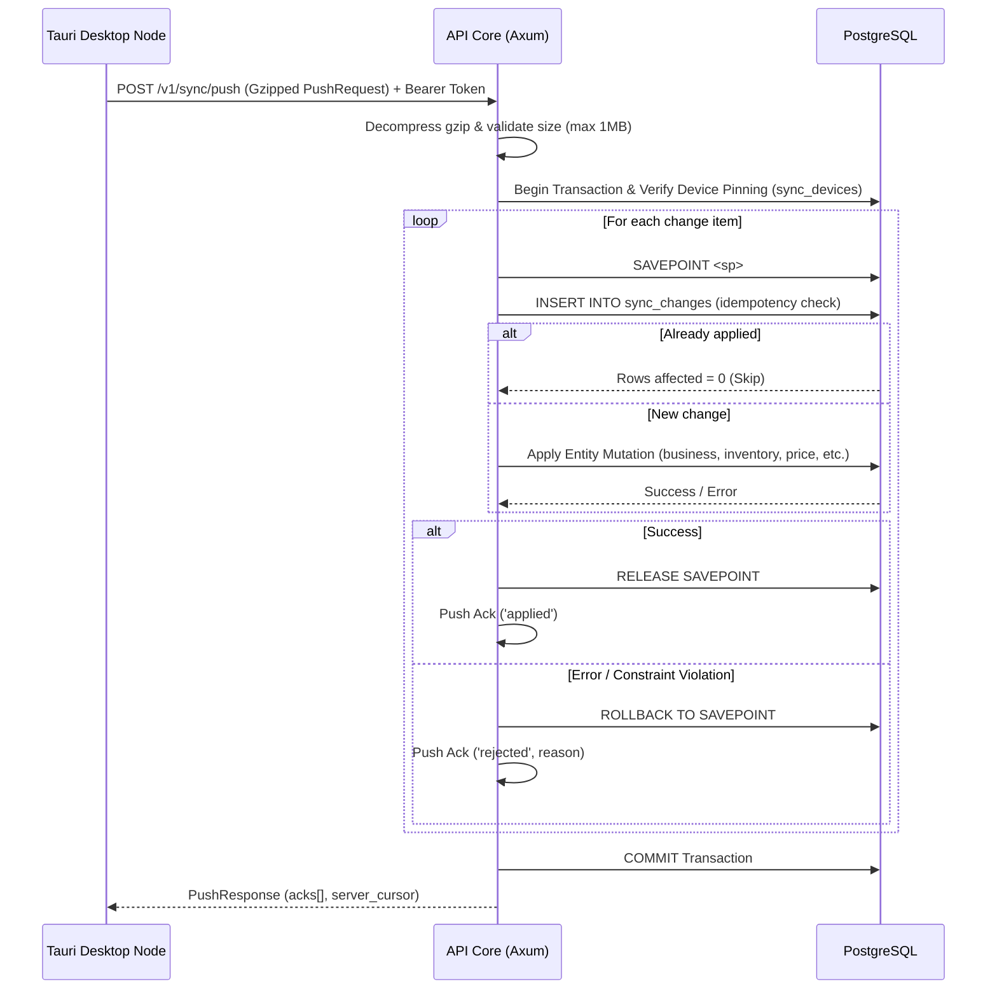

# API Sync & Push Protocol — 40Labs Core API

## Overview
Phase 2A Push Sync protocol enables offline-first desktop nodes (Tauri SQLite) to synchronize local mutations with the cloud Postgres backend via gzip-compressed JSON payloads.

---

### POST /v1/sync/push
**Status:** LIVE   **Phase:** Phase 2A (Sync)
**Source:** `services/api-core/src/sync/push.rs:push_handler`
**Purpose:** Push a batch of local SQLite entity changes to the cloud backend with transaction savepoints and idempotency.
**Auth:** Device Token (`Authorization: Bearer <base64url-encoded-device-claims>`)
**Roles:** Device / Staff
**Scoping:** `workspace_id` from device claims.
**Offline behavior:** Queued locally via outbox; pushed when online.
**Audit:** Change items tracked in `sync_changes` idempotency table.

**Request:**
- **Headers:**
  - `Authorization: Bearer <token>`
  - `Content-Encoding: gzip`
  - `Content-Type: application/json`
- **Body:** Gzipped JSON byte array (max 1 MB decompressed) representing `PushRequest`:
```json
{
  "device_id": "dev_987654321",
  "app_version": "0.1.0",
  "changes": [
    {
      "change_id": "chg_001",
      "entity": "inventory_item",
      "entity_id": "inv_123",
      "version": 1,
      "payload": {
        "id": "inv_123",
        "workspace_id": "ws_123456",
        "branch_id": "branch_123",
        "medicine_id": "med_999",
        "batch_number": "BATCH-2025-A",
        "expiry_date": "2026-12-31",
        "buy_price": 5000,
        "sell_price": 7500,
        "quantity": 100,
        "low_stock_threshold": 10,
        "cold_chain_required": false,
        "is_deactivated": false,
        "version": 1,
        "deleted_at": null,
        "created_at": "2025-02-15T08:00:00Z",
        "updated_at": "2025-02-15T08:00:00Z"
      }
    }
  ]
}
```

**Response (200 OK):**
```json
{
  "acks": [
    {
      "change_id": "chg_001",
      "status": "applied",
      "reason": null
    }
  ],
  "server_cursor": "2025-02-15T10:30:00.000Z"
}
```

**Errors:**
- `400 BAD_REQUEST`: Invalid JSON, decompression failure, or size > 1MB.
- `401 UNAUTHORIZED`: Missing or invalid device token.
- `409 CONFLICT`: Device pinning mismatch (`sync_devices` table pinned to another device ID for this workspace).

---

### POST /v1/sync/heartbeat
**Status:** LIVE   **Phase:** Phase 2A (Sync)
**Source:** `services/api-core/src/sync/push.rs:heartbeat_handler`
**Purpose:** Update device last seen timestamp and pending outbox count.
**Auth:** Device Token (`Authorization: Bearer <token>`)

---

### GET /v1/business/verification
**Status:** LIVE   **Phase:** Phase 1 / Admin
**Source:** `services/api-core/src/sync/push.rs:verification_handler`
**Purpose:** Query the business verification status (`pending_review`, `verified`, `rejected`), TMDA registration status, and labs verification flag.
**Auth:** Device Token (`Authorization: Bearer <token>`)

**Response (200 OK):**
```json
{
  "status": "verified",
  "labs_verified": true,
  "tmda_registered": true,
  "rejection_reason": null,
  "updated_at": "2025-02-15T09:00:00Z"
}
```

## Mermaid Sequence Diagram

